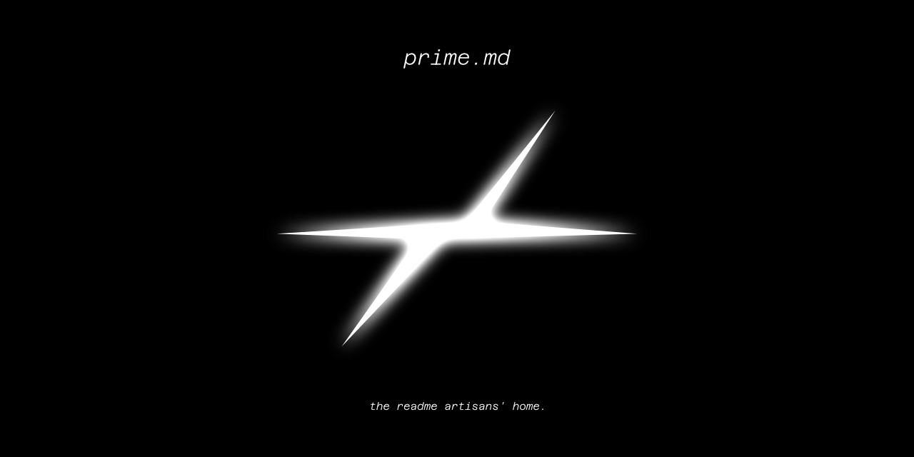

Prime.md is a place for mind-blowing, and very well crafted personal, and project README files.

> ℹ️ *To add your README for review, create an issue.*

<br>

<h4>
    BADGE &nbsp;&nbsp;&nbsp;
    <a href="https://github.com/anafro/prime.md"></a>
</h4>

Once your README is prime-awarded, you can add our badge. Put the following code into your `.md` file.

```html
<a href="https://github.com/anafro/prime.md"></a>
```

<br><br><br>

<h3 align="center">
LIST
</h3>

##### Ergonomic

[`mantrakp04/ardia`](https://github.com/mantrakp04/ardia) &mdash; clean, easy-to-read considering text size; 
an amazing example of layout engineering.<br>
[`amir20/dozzle`](https://github.com/amir20/dozzle) &mdash; rich of docs links, it makes people learn the tool faster
by reducing clicks;

##### Laconic
[`MikalaiKryvusha`](https://github.com/MikalaiKryvusha) &mdash; despite project section size, it's buttery-smooth to read;
also very nice layout usage over sections;


##### Visually Impressive
[`burjoawl`](https://github.com/burjoawl) &mdash; interesting layout usage, and gif makes it unique, and alive;

##### Hilarious

[`adamdotdevin/good-repo`](https://github.com/adamdotdevin/good-repo) &mdash; we couldn't skip this one, could we? good repo, indeed.


<br><br><br>

#### LORE
*There are several lists like ours. However, these are not updated, nor maintained well.*

<br>
<br>

<hr>
Anatoly Frolov &copy; 2015-2026. All rights reserved